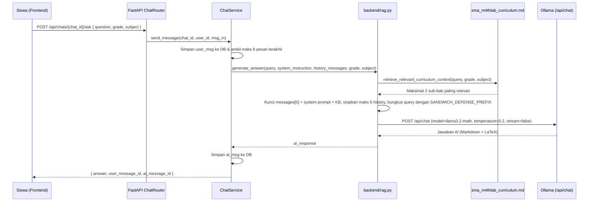

# Design Document: Asisten AI Matematika SMA & Backend Guardrails

## Overview
Dokumen ini merinci arsitektur sistem pengamanan berlapis (*Defense-in-Depth*) dan orkestrasi prompt pada **MathAI**. Seluruh logika *guardrail*, pengayaan konteks kurikulum (`sma_m4thlab_curriculum.md`), pembatasan riwayat obrolan, serta komunikasi ke mesin AI **Ollama** (`llama3.2-math` / `llama3.2:3b`) dikendalikan sepenuhnya di sisi backend (`backend/rag.py` dan `backend/services/chat_service.py`).

---

## Architecture & Data Flow

### Urutan Array `messages` ke Ollama
1. `messages[0]`: `{"role": "system", "content": locked_system_prompt}` — selalu terkunci di indeks ke-0, tersusun dari `SMA_MATH_SYSTEM_PROMPT`, konteks sesi belajar (`grade` & `subject`), dan maksimal 2 sub-bab hasil retrieval dari `backend/knowledge_base/sma_m4thlab_curriculum.md`.
2. `messages[1..N]`: Maksimal `MAX_HISTORY_MESSAGES = 6` pesan riwayat terakhir (`user` / `assistant`) yang diurutkan kronologis.
3. `messages[-1]`: `{"role": "user", "content": sanitized_user_message}` — input pertanyaan terbaru yang dibungkus oleh `build_sanitized_user_message()` dengan `SANDWICH_DEFENSE_PREFIX`.

---

## Components Affected

| Komponen / File | Peran & Perubahan Desain |
| :--- | :--- |
| `Modelfile` | Mendefinisikan model dasar `llama3.2:3b`, parameter deterministik (`temperature 0.2`, `top_p 0.9`, `top_k 40`, `repeat_penalty 1.15`, `num_ctx 8192`), dan blok `SYSTEM` berisi identitas serta aturan penolakan mutlak. |
| `backend/core/config.py` | Menyediakan konfigurasi `OLLAMA_BASE_URL` dan `OLLAMA_MODEL` melalui Pydantic `BaseSettings`. |
| `backend/rag.py` | Menyimpan `SMA_MATH_SYSTEM_PROMPT` (raw string untuk notasi LaTeX `\mathbb`), `LLM_TEMPERATURE = 0.2`, `MAX_HISTORY_MESSAGES = 6`, `retrieve_relevant_curriculum_context()`, `build_system_prompt()`, `build_sanitized_user_message()`, dan `_call_ollama_chat()` menggunakan `httpx.Client` dengan fallback ke `llama3.2:3b`. |
| `backend/services/chat_service.py` | Mengambil maksimal 6 pesan terakhir sebelum pesan user saat ini dan meneruskannya ke `rag.generate_answer()`. |
| `backend/knowledge_base/sma_m4thlab_curriculum.md` | Sumber kebenaran (*grounding scope*) materi Matematika Wajib & Peminatan Kelas X–XII. |
| `frontend/src/components/organisms/WelcomeForm/WelcomeForm.tsx` | Menyediakan selector `GRADES` (`Kelas 10`, `Kelas 11`, `Kelas 12`) dan 7 topik utama `SUBJECTS`. |
| `frontend/src/components/molecules/ChatBubble/ChatBubble.tsx` | Merender Markdown + LaTeX melalui `preprocessLaTeX()`, `remark-math`, dan `rehype-katex`. |

---

## Technical Constraints
1. **Low Temperature Determinism:** `temperature = 0.2` dijaga seragam di `Modelfile` dan payload JSON `_call_ollama_chat()` untuk menekan halusinasi aljabar dan kebocoran *guardrail*.
2. **Error Resilience:** Klien Ollama (`httpx.Client(timeout=180.0)`) otomatis melakukan fallback ke `OLLAMA_FALLBACK_MODEL` (`llama3.2:3b`) jika model kustom `llama3.2-math` mengembalikan HTTP `404`.
3. **Secret & Prompt Isolation:** `System_Prompt` hanya disusun di backend dan tidak pernah dikirim atau diekspos ke frontend.
